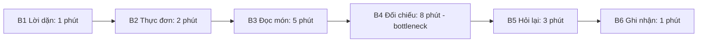
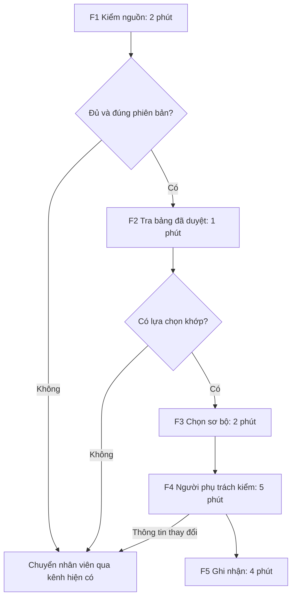

# Báo cáo nhóm — A90

## 1. Thông tin nhóm

- Thành viên và đóng góp: [TEAM.md](TEAM.md).
- Candidate được chọn: **Khi đã biết lời dặn ăn uống và đứng trước nhiều món, bệnh nhân muốn biết nhanh món nào phù hợp, để chọn tự tin mà không phải đọc kỹ từng món.**
- Mức chọn: **No AI**.
- Quyết định: **Not Yet**.
- Phạm vi sau kiểm chứng: người đang tự đọc và đối chiếu thực đơn, gồm bệnh nhân hoặc người nhà hỗ trợ; không thay người có chuyên môn xác định chế độ ăn.

## 2. Hội tụ nhóm — CP3

### 2.1. Pitch và phản biện

Mỗi người trình bày ba card. Nhóm ghi câu hỏi và thay đổi vào [sổ P01–P15](cp3-phan-bien.md), trước khi biết kết quả kiểm chứng ở CP4.

| Người đề cử | Ba candidate | Phản biện tiêu biểu nhận được | Thay đổi |
|---|---|---|---|
| Linh | Kiểm bài; làm rõ nhiệm vụ; chốt việc sau họp | P01 từ Mạnh: 10 phút nhưng vẫn sót thì cần tối ưu điều gì? | Bổ sung cách kiểm hiểu đúng và lỗi còn sót, không chỉ tốc độ |
| Mạnh | Chọn món; truyền thay đổi chế độ ăn; ghi lý do thức ăn thừa | P04 từ Linh: 20 phút là mỗi bữa/ngày? P13 từ Chủ: nhãn đã đủ chưa? | Đưa đơn vị baseline và hiệu quả cách hiện tại vào giả định phải kiểm |
| Khánh | Hiểu đề lab; tra Git; đi học đúng giờ | P07 từ Linh: 45 phút định hình có giải thích toàn bộ tiến độ không? | Tách đọc hiểu, thực hiện và sửa lỗi; không suy ra quan hệ nguyên nhân |
| Chủ | Xác minh chuyển tiền; tin tuyển dụng; hồ sơ thuê trọ | P10 từ Khánh: dấu hiệu nội dung có xác minh được danh tính không? | Chuyển đầu ra sang hỗ trợ xác minh, giữ trạng thái chưa đủ dữ kiện |

### 2.2. Cluster

| Cluster | Candidate | Pattern |
|---|---|---|
| A — Đọc/đối chiếu nhiều nguồn | Kiểm bài, nhận nhiệm vụ, hiểu đề, xác minh tin, chọn món | Điều kiện và nguồn nằm rải rác, khó đối chiếu |
| B — Phối hợp và chuyển trạng thái | Chốt việc, đổi chế độ ăn | Người nhận và trạng thái hiệu lực chưa rõ |
| C — Ghi nhận lặp lại | Tra Git, ghi lý do thức ăn thừa | Tác vụ nhỏ nhưng lặp, có khả năng chuẩn hóa |
| D — Di chuyển | Đi học đúng giờ | Cần kiểm giờ thực tế và thời gian dự phòng |

### 2.3. Opportunity Solution Tree

```text
OUTCOME: Giảm thời gian chọn món mà lựa chọn vẫn khớp điều kiện đã được xác nhận
├── Khó nối lời dặn với thông tin từng món
├── Chưa rõ thông tin món và lời dặn có cùng phiên bản hay không
└── Cần được hỗ trợ khi không tự đọc/đối chiếu được
```

Nhóm gạch “chatbot tư vấn ăn uống” và “AI đọc bệnh án” khỏi tầng opportunity vì đó là giải pháp. Nhóm chưa quyết định dùng AI tại bước này.

### 2.4. So sánh shortlist và chốt

Điểm 1–5 được dùng để buộc nhóm giải thích lựa chọn, không thay thế thảo luận.

| Candidate | Actor rõ | Quy trình rõ | Pain có bằng chứng ban đầu | Impact đo được | Vừa sức lab | So sánh 4 mức | Hiểu domain | Tổng |
|---|---:|---:|---:|---:|---:|---:|---:|---:|
| Chọn món theo lời dặn | 5 | 4 | 2 | 4 | 3 | 5 | 3 | 26 |
| Kiểm tra bài trước nộp | 5 | 5 | 3 | 5 | 5 | 4 | 5 | 32 |
| Xác minh yêu cầu chuyển tiền | 4 | 4 | 2 | 3 | 3 | 4 | 3 | 23 |

**Chọn:** card chọn món. Nhóm muốn đào sâu việc đối chiếu nhiều nguồn trong một tình huống có actor và đầu ra cụ thể; Mạnh có thể hỗ trợ tiếp cận người có trải nghiệm. Nhóm nhận rõ đây không phải card có mức sẵn sàng cao nhất và chấp nhận kết luận Not Yet nếu thiếu điều kiện.

**Không chọn kiểm bài trong vòng này:** thuận tiện hơn cho lab nhưng có thể tiếp tục xử lý bằng checklist cá nhân; nhóm chọn một bối cảnh chung khác để thực hành kiểm chứng. **Không chọn chuyển tiền:** khó đánh giá chất lượng quyết định trong trạng thái bị thúc ép và không muốn mở phạm vi sang xác thực danh tính.

**Bất đồng:** Linh ban đầu ưu tiên kiểm bài vì dễ đo. Nhóm thống nhất chọn card suất ăn với điều kiện kiểm cách hiện tại trước, không cam kết xây sản phẩm hay dùng AI. Lập luận này được đưa vào hướng kiểm chứng và quyết định cuối.

## 3. Kiểm chứng và research — CP4

### 3.1. Assumption Map

Điểm bằng chứng được cập nhật sau I01–I03; 1 là rất ít, 5 là mạnh.

| ID | Giả định | Loại | Quan trọng | Bằng chứng | Việc ưu tiên |
|---|---|---|---:|---:|---|
| A1 | Pain nằm ở tự đối chiếu lời dặn với món | Value | 5 | 3 | Đối chiếu hai lượt và không suy rộng mọi người |
| A2 | Có bảng món đủ thông tin và phiên bản để lập danh sách duyệt | Feasibility | 5 | 1 | Xin mẫu dữ liệu và kiểm nguồn |
| A3 | Có người nhận trách nhiệm duyệt/cập nhật và xử lý ngoại lệ | Viability | 5 | 1 | Xác nhận vai trò trước pilot |
| A4 | Người dùng hoặc người nhà dùng được cách trình bày | Usability | 4 | 2 | Kiểm riêng khả năng tự đọc và có người hỗ trợ |
| A5 | Nhãn/nhân viên hiện có chưa đủ cho nhóm actor đã chọn | Value | 5 | 2 | Giữ I03 là tín hiệu phản bác, thu hẹp actor |
| A6 | Lợi ích đủ bù công chuẩn bị và cập nhật | Feasibility / Viability | 4 | 1 | Đo công theo phiên bản thực đơn |

### 3.2. Kiểm chứng và điều đã thay đổi

Nhóm trao đổi với ba người ngoài nhóm và tái hiện hai lượt lựa chọn. [I01–I03 và U01–U02](cp4-bang-chung.md) ghi vai trò, cách hỏi, câu nguyên văn, cách xử lý hiện tại, thời gian và giới hạn.

| Nguồn | Số mẫu | Xác nhận | Phản bác / giới hạn |
|---|---:|---|---|
| Người từng nội trú, người nhà | 2 | Có khó khăn đọc/đối chiếu; dùng cách hỏi lại khi chưa rõ | Tái hiện không hoàn toàn giống một bữa ăn thật |
| Nhân viên liên quan suất ăn | 1 | Có nhu cầu giữ nguồn và người xác nhận khi có ngoại lệ | Một số người đã được hỗ trợ nên không cần tự đọc từng món |
| Ghi thời gian U01/U02 | 2 lượt | Tổng 22/18 phút; B4 đối chiếu 9/7 phút | Mẫu nhỏ; không đại diện thời gian toàn bệnh viện |

**Sửa problem:** từ mọi bệnh nhân sang người phải tự đọc/đối chiếu; làm rõ baseline là một lượt tái hiện; giữ người nhà hỗ trợ; không đặt mục tiêu thay nhân viên. Nhóm chuyển từ muốn làm công cụ giải thích ngay sang thử cách trình bày có nguồn trước.

### 3.3. Research giải pháp đã có

Chủ tự mở từng link, ghi tính năng được mô tả và tránh suy ra kiến trúc bên trong từ tên sản phẩm.

| Công cụ / case | Nguồn | Giải bước nào | Điểm mạnh | Khoảng trống / bài học |
|---|---|---|---|---|
| CBORD Patient tại Cambridge Memorial Hospital | [Hướng dẫn chính thức](https://www.cmh.org/patients/how-order-patient-meals) | Xem lựa chọn và hỗ trợ ghi nhận | Có điều kiện sử dụng và kênh hỗ trợ | Không mặc định mọi người dùng được; kiểm dữ liệu và fallback |
| HS onTray tại PVHMC | [Thông tin từ bệnh viện](https://www.pvhmc.org/blog/2025/july/pvhmc-receives-prodigy-award-for-innovation-from/) | Chọn suất theo điều kiện đã chỉ định | Triển khai theo giai đoạn | Không suy ra mức giảm thời gian của nhóm hoặc sự cần thiết của AI |
| MyChart Bedside tại UW Health | [Hướng dẫn thao tác](https://www.uwhealth.org/files-directory/mychart/Dining/MYC_MealOrder.pdf) | Chọn bữa và ghi nhận đơn | Có đường hỗ trợ khi không thao tác được | Phải xử lý điều kiện thay đổi, không tiếp tục dùng danh sách cũ |

**Kết luận:** đã có pattern phù hợp; chưa có lý do tự xây Agent. Dữ liệu và cách phối hợp quan trọng hơn việc chọn mô hình tạo nội dung. Nhóm giữ No AI là phương án đầu tiên.

## 4. Quy trình trước/sau — CP5

### 4.1. Hiện tại

Actor: người chọn hoặc người nhà hỗ trợ; nhân viên xử lý điểm chưa rõ. Bắt đầu khi tiếp cận lời dặn và thực đơn, kết thúc khi ghi nhận lựa chọn. Bảng dưới là trung bình các bước từ U01/U02, không phải số của mọi người dùng.

| Bước | Actor | Input | Output | Phút trung bình |
|---:|---|---|---|---:|
| B1 | Người chọn | Lời dặn hiện hành | Điều kiện để đối chiếu | 1 |
| B2 | Người chọn | Thực đơn | Các món cần xem | 2 |
| B3 | Người chọn | Thông tin món | Thông tin đã đọc | 5 |
| B4 | Người chọn | Điều kiện và món | Lựa chọn sơ bộ/điểm chưa rõ | 8 |
| B5 | Nhân viên và người chọn | Câu hỏi | Xác nhận hoặc ngoại lệ | 3 |
| B6 | Người nhận lựa chọn | Lựa chọn đã xác nhận | Bản ghi | 1 |
| **Tổng** | | | | **20** |



B4 lâu nhất trong cả U01 và U02. Tổng trung vị 20 phút là baseline tạm thời từ hai lượt tái hiện; cần mở rộng quan sát trước khi kết luận về vận hành.

### 4.2. Tương lai

Nhóm đề xuất nhãn/danh sách giấy được người phụ trách duyệt theo phiên bản. Bảng thời gian sau là ngân sách thiết kế, chưa phải kết quả đã đạt.

| Bước | Mức / actor | Input → output | Phút mục tiêu |
|---:|---|---|---:|
| F1 | Con người | Nguồn/phiên bản → xác nhận đủ dữ liệu | 2 |
| F2 | Con người, No AI | Tra nhãn/bảng duyệt → danh sách để xem | 1 |
| F3 | Người chọn/người nhà | Danh sách → lựa chọn sơ bộ | 2 |
| F4 | Người phụ trách | Lựa chọn → xác nhận hoặc ngoại lệ | 5 |
| F5 | Người nhận lựa chọn | Xác nhận → bản ghi qua kênh hiện có | 4 |
| **Tổng mục tiêu** | | | **14** |



**Boundary:** không tự xác định chế độ ăn, dị ứng hoặc thành phần chưa rõ; không nới điều kiện để có thêm món; không tự đặt món. **Fallback:** thiếu/cũ dữ liệu, không có món khớp hoặc người dùng không thao tác được thì dừng danh sách và chuyển nhân viên; giữ trạng thái chưa xác nhận.

### 4.3. Before/after

| Chỉ số | Trước | Sau — kỳ vọng |
|---|---|---|
| Số bước | 6 | 5, không tính chuẩn bị bảng trước lượt |
| Tổng thời gian một lượt | Trung vị 20 phút ở U01/U02 | ≤14 phút, gồm kiểm/sửa; ghi thêm chờ phát sinh |
| Bước thủ công | 6/6 | 5/5; không cần tự động hóa để có giá trị |
| Bottleneck | Đối chiếu B4 | Người phụ trách kiểm F4; giữ để kiểm chất lượng |
| Rủi ro mới | Chưa có danh sách hỗ trợ mới | Có thể tin nhầm nhãn hoặc dùng bản cũ |

Mức giảm kỳ vọng = (20−14)/20 = 30%. Nhóm dự trù công chuẩn bị 60 phút/phiên bản để kiểm chi phí: với N lượt, 20N so với 60+14N; hòa vốn ở 10 lượt nếu không phát sinh cập nhật. Dự trù này cần đo, không dùng như số công thực tế đã xác nhận.

## 5. Problem Statement v0 — CP5

| Trường | Nội dung |
|---|---|
| Actor | Bệnh nhân nội trú và người nhà hỗ trợ lựa chọn |
| Quy trình | Nhận lời dặn → xem món → đọc → đối chiếu → hỏi lại → ghi nhận |
| Bottleneck | B4 đối chiếu, trung bình 8 phút trong hai lượt tái hiện |
| Impact | Lượt tái hiện 22/18 phút; có thể phải hỏi lại, chưa có tỷ lệ lỗi hoặc tác động toàn cơ sở |
| Success Metric | Baseline trung vị 20 phút/lượt tái hiện → target ≤14 phút trên cùng phạm vi; tính cả kiểm/sửa |
| Boundary | Không thay người có chuyên môn xác định điều kiện; không suy đoán; có người kiểm cuối |

**Phản biện nhận được:** metric chỉ đo tốc độ; actor quá rộng khi I03 cho thấy nhiều người đã có hỗ trợ; chưa tính phiên bản và công chuẩn bị. Nhóm giữ nhận xét và sửa ở v1.

## 6. Mức can thiệp — CP6

### 6.1. Ma trận

Đối chiếu theo điều kiện đã duyệt có độ mơ hồ thấp. Dữ liệu và phối hợp nhiều bên làm quy trình phức tạp hơn, nhưng chưa chứng minh cần tạo nội dung hoặc tự quyết bước tiếp theo.

### 6.2. So sánh và chọn

| Mức | Phương án | Đủ khi nào | Rủi ro | Chọn? |
|---|---|---|---|---|
| No AI | Nhãn/danh sách có nguồn, người hỗ trợ | Có thể trình bày rõ với phạm vi nhỏ | Dữ liệu cũ hoặc nhãn sai | **Có, vòng đầu** |
| Rule | Lọc nhiều điều kiện từ bảng đã duyệt | No AI không đủ, dữ liệu có cấu trúc và cập nhật được | Sai đầu vào, sai phiên bản | Chưa |
| Workflow | Rule rồi AI giải thích có nguồn, người kiểm | Có bằng chứng phần giải thích còn gây khó | Bịa diễn giải, tăng công kiểm | Không |
| Agent | Tự tìm thông tin, tự chọn bước | Chưa có nhu cầu được chứng minh | Quyền và phạm vi khó kiểm soát | Không |

**Vì sao không cần mức cao hơn:** I01/I02 cần hiểu và tin nguồn; I03 cho thấy hỗ trợ hiện có có thể đã đủ. Chưa thử cách trình bày đơn giản nên chưa có căn cứ thêm tự động hóa. Vì chọn No AI, AI Canvas và PAIR cho giải pháp AI không áp dụng; tiêu chí được viết cho nhãn/danh sách và quy trình người dùng.

## 7. Problem Statement v1 và tiêu chí đánh giá

| Trường | Nội dung |
|---|---|
| Actor | Người đang phải tự đọc/đối chiếu thực đơn có thông tin chưa được tổ chức rõ; có thể là bệnh nhân hoặc người nhà |
| Quy trình | Giữ kênh nhận lựa chọn hiện có, thêm cách trình bày dữ liệu đã duyệt và bước kiểm phiên bản |
| Bottleneck | Đối chiếu B4; mới có hai lượt tái hiện, cần xác nhận rộng hơn |
| Impact | Baseline tạm thời 20 phút/lượt, không suy rộng mọi bệnh nhân |
| Success Metric | Trung vị ≤14 phút sau khi vượt kiểm chất lượng; 0 lựa chọn không khớp bảng duyệt trong tập thử; 100% ca thiếu/cũ được chuyển xác nhận |
| Boundary | Không suy đoán phần thiếu hoặc thay điều kiện chuyên môn; không tự đặt món; giữ người kiểm |
| AI intervention point | Không có, chưa chứng minh cần tạo nội dung |
| Mức chọn | No AI |
| Rủi ro và người kiểm | Người phụ trách do cơ sở chỉ định cần kiểm bảng và ngoại lệ; vai trò chưa được xác nhận nhận trách nhiệm cho pilot |

| Trường | v0 | v1 | Vì sao đổi |
|---|---|---|---|
| Actor | Bệnh nhân nói chung và người nhà | Người phải tự đọc/đối chiếu | Tín hiệu phản bác I03 |
| Metric | Chỉ thời gian | Thêm khớp bảng, thiếu/cũ và chất lượng | Phản biện nhanh hơn chưa đủ |
| Boundary | Giữ người kiểm | Thêm nguồn/phiên bản và dừng khi thiếu | Research và dữ liệu chưa đủ |

| # | Tiêu chí | Đạt | Không đạt |
|---:|---|---|---|
| 1 | Khớp bảng duyệt | Mọi lựa chọn được bảng hiện hành cho phép | Có lựa chọn bảng loại vẫn được cho chọn |
| 2 | Không suy đoán | Thiếu/cũ chuyển xác nhận | Tự điền phần thiếu hoặc dùng bản hết hiệu lực |
| 3 | Truy vết | Có nguồn và phiên bản | Không truy được căn cứ |
| 4 | Có hỗ trợ | Có kênh thay thế cho người không tự thao tác | Người dùng bị kẹt, không có người nhận |
| 5 | Có lợi ích | Đạt thời gian khi tính đủ kiểm/sửa và công ngoài lượt | Chỉ nhanh vì bỏ bước hoặc bỏ chi phí |

Nhóm chuẩn bị mười tình huống đánh giá bằng mã trừu tượng: đủ dữ liệu, không khớp điều kiện, thiếu nhãn, điều kiện loại trừ, thiếu trường bắt buộc, đổi phiên bản, hết món, không còn lựa chọn, không tự thao tác và yêu cầu vượt boundary. Mỗi tình huống có kết quả mong đợi; chưa có sản phẩm vận hành để báo tỷ lệ đạt.

## 8. Quyết định

| Rủi ro | Mức | Lý do |
|---|---|---|
| Value | Trung bình | I01/I02 xác nhận khó khăn, I03 phản bác tính phổ quát; mẫu nhỏ |
| Usability | Trung bình | Có một người nhà hỗ trợ nhưng chưa bao phủ người không tự đọc được |
| Feasibility | Cao | Chưa có bảng món đầy đủ, phiên bản và cách cập nhật được xác nhận |
| Viability | Cao | Chưa có người nhận trách nhiệm duyệt, vận hành và công cập nhật |

**Not Yet.** Nhóm chọn đề tài và cách thử, nhưng chưa có đủ điều kiện pilot tại cơ sở.

**Bước tiếp theo:** xem dữ liệu món được phép dùng; xác nhận người duyệt; quan sát thêm cùng phạm vi; thử nhãn/danh sách trước. Nếu đủ điều kiện, pilot nhỏ nhất là một phiên bản thực đơn, một nhóm người dùng đủ điều kiện và một người phụ trách kiểm cuối.

**Ngưỡng dừng:** hết một tuần chuẩn bị chưa có nguồn và người duyệt thì dừng pilot tại cơ sở; một lựa chọn không khớp bảng trong kiểm thử thì dừng bản thử; nếu cách hiện tại đã đạt target thì không thêm công cụ. Chỉ đánh giá lại Go khi không còn rủi ro Cao.

## 9. Hạn chế và hướng tiếp theo

Mẫu hai lượt nhỏ, là tái hiện chứ chưa đo vận hành; người nhà không đại diện mọi bệnh nhân. Nhóm chưa biết tỷ lệ lỗi, tần suất chọn và công chuẩn bị thật. Bước tiếp theo nhằm giảm các điều chưa biết này, không nhằm chứng minh bằng mọi cách rằng ý tưởng ban đầu đúng.

## 10. Tài liệu tham khảo

- [Sổ phản biện và thay đổi](cp3-phan-bien.md).
- [Snapshot và nhật ký thời gian](cp4-bang-chung.md).
- [Cambridge Memorial Hospital](https://www.cmh.org/patients/how-order-patient-meals).
- [PVHMC](https://www.pvhmc.org/blog/2025/july/pvhmc-receives-prodigy-award-for-innovation-from/).
- [UW Health](https://www.uwhealth.org/files-directory/mychart/Dining/MYC_MealOrder.pdf).
- [TEAM](TEAM.md), [RUBRIC](../../../RUBRIC.md).
