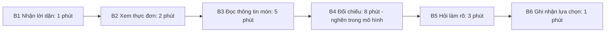
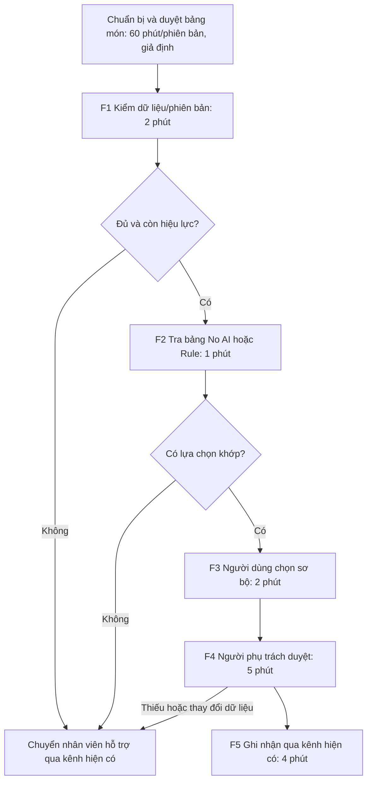

# CP5 — Quy trình trước/sau và phản biện

Đầu vào là card chung và [research CP4](cp4-research-va-ke-hoach-kiem-chung-ai.md).

## 1. Đơn vị đo và phạm vi mô hình

- Bắt đầu: người chọn có thể tiếp cận lời dặn đã xác nhận và thực đơn của lượt tương ứng.
- Kết thúc: lựa chọn được kiểm và ghi nhận qua kênh hiện có; không bao gồm nấu, giao hoặc ăn.
- Các số phút là công thao tác tuần tự cộng được trong một ca thiết kế, không bao gồm chờ phát sinh. Nếu thực tế có chờ, phải ghi thêm và dùng tổng thời gian cùng phạm vi để so target.
- Kịch bản hiện tại có một lượt hỏi làm rõ; trường hợp không hỏi sẽ có đường đi khác và không mặc định mất 20 phút.
- Không có y lệnh, tiêu chí dinh dưỡng hoặc hồ sơ người bệnh thật được AI tạo trong tài liệu này.

## 2. Quy trình hiện tại — mô hình sáu bước

| Bước | Actor | Input | Output / handoff | Phút thiết kế | Chưa được xác minh |
|---:|---|---|---|---:|---|
| B1 | Bệnh nhân/người hỗ trợ | Lời dặn đã xác nhận | Điều kiện để đối chiếu, chuyển B2 | 1 | Kênh tiếp nhận lời dặn thực tế |
| B2 | Bệnh nhân/người hỗ trợ | Thực đơn của lượt | Các món cần xem, chuyển B3 | 2 | Nhãn và thông tin hiện có |
| B3 | Bệnh nhân/người hỗ trợ | Thông tin món | Thông tin cần đối chiếu, chuyển B4 | 5 | Nội dung thành phần đủ hay thiếu |
| B4 | Bệnh nhân/người hỗ trợ | Lời dặn và thông tin món | Lựa chọn sơ bộ/điểm chưa rõ | 8 | Có phải bước lâu nhất thực tế không |
| B5 | Nhân viên phụ trách và người chọn | Câu hỏi từ B4 | Xác nhận hoặc chuyển ngoại lệ | 3 | Thời gian thao tác và chờ thực tế |
| B6 | Người chọn/nhân viên nhận lựa chọn | Lựa chọn đã xác nhận | Bản ghi qua kênh hiện có | 1 | Kênh và thời điểm nhận lựa chọn |
| **Tổng** | | | **Một ca có hỏi làm rõ** | **20** | **Tổng hợp, không phải baseline đo** |

B4 là bước lớn nhất **trong mô hình**: 8/20 = 40%. B3+B4 = 13 phút, 65%. Các tỷ trọng không được ghi thành quan sát của Mạnh hay bệnh nhân.

## 3. Chuẩn bị trước lượt và quy trình tương lai

Trước lượt: người phụ trách do cơ sở chỉ định kiểm nguồn lời dặn, bảng món/nhãn, điều kiện tương thích, phiên bản và tình trạng cung ứng. Công chuẩn bị giả định **60 phút cho một phiên bản thực đơn**, chỉ dùng để tính chi phí thiết kế; chưa đo và chưa biết khối lượng thật. Đây là vai trò chuyên môn cần cơ sở xác nhận, không tự giao cho một thành viên nhóm.

| Bước | Cách đơn giản No AI | Biến thể Rule nếu cần và đủ dữ liệu | Actor chịu trách nhiệm | Phút thiết kế |
|---:|---|---|---|---:|
| F1 | Kiểm nguồn và phiên bản trên danh sách giấy/nhãn đã duyệt | Kiểm trường bắt buộc, phiên bản và trạng thái dữ liệu | Nhân viên phụ trách; kiểm tự động không thay người duyệt | 2 |
| F2 | Tra bảng có nhãn đã duyệt, không tự suy đoán | Rule đối chiếu bảng tương thích và món còn sẵn | Người tra bảng hoặc bộ lọc theo quy tắc được duyệt | 1 |
| F3 | Người dùng xem danh sách và chọn sơ bộ | Cùng bước chọn sơ bộ, có nguồn/phiên bản hiển thị | Bệnh nhân/người hỗ trợ | 2 |
| F4 | Người phụ trách xác nhận lựa chọn và xử lý điểm chưa rõ | Cùng bước duyệt; không bỏ vì đã có bộ lọc | Nhân viên phụ trách | 5 |
| F5 | Ghi nhận qua kênh hiện có, giữ trạng thái chưa chốt nếu cần | Cùng kênh hiện có, không tự gửi đặt món | Người chọn/nhân viên nhận lựa chọn | 4 |
| **Tổng** | **Mô hình thiết kế, chưa thử** | **Thời gian bằng nhau là giả định để diễn tập, không phải so sánh đã đo** | | **14** |

No AI được thử trước. Rule chưa được chứng minh nhanh hơn No AI; phải so sánh cùng dữ liệu nếu định chọn Rule. Không có bước AI tạo nội dung trong hai phương án này.

**Boundary:** không tự suy đoán chế độ ăn, dị ứng, thành phần hoặc quyền dùng dữ liệu; không nới điều kiện khi không có món; không tự đặt món. Người có thẩm quyền xác nhận thông tin chuyên môn; nhóm chỉ thiết kế quy trình hỗ trợ.

**Phương án quay về:** thiếu/cũ dữ liệu, đổi điều kiện, không có món khớp, mất kết nối hoặc người dùng không thao tác được → dừng danh sách hiện tại, giữ trạng thái chưa xác nhận và chuyển nhân viên theo kênh hiện có. Không tiếp tục với bản cũ để đạt thời gian target.

## 4. Before/after và công chuẩn bị

| Chỉ số | Hiện tại trong mô hình | Tương lai trong mô hình | Diễn giải |
|---|---:|---:|---|
| Bước thao tác mỗi lượt | 6 | 5 | Không tính chuẩn bị trước lượt; các nhánh ngoại lệ không ép vào 5 bước |
| Tổng phút thao tác cộng được | 20 | 14 | Giảm 6 phút/lượt, tương đương 30% trong mô hình |
| Bước thủ công theo phương án No AI | 6/6 | 5/5 | Giảm việc đọc/đối chiếu lại nhờ bảng đã chuẩn bị, không phải nhờ tự động hóa |
| Bước thủ công theo biến thể Rule | 6/6 | 4/5 nếu F2 được tự động hóa | F1 vẫn cần người chịu trách nhiệm; chưa có kết quả thực nghiệm |
| Bước lâu nhất | B4: 8 phút | F4: 5 phút | Điểm duyệt trở thành phần kiểm soát chất lượng |
| Công chuẩn bị được thêm để kiểm chi phí | Chưa xác định | Giả định 60 phút/phiên bản | Không được bỏ khỏi tính khả thi; chưa tính chi phí nền của cách hiện tại |
| Rủi ro mới | Đọc và hiểu nhầm | Nhãn sai, phiên bản cũ, tin nhầm bộ lọc | Giữ nguồn, duyệt và fallback |

Mô hình chi phí bổ sung dùng cùng đơn vị phút công: `trước = 20 × N`, `sau = 60 + 14 × N`. Hòa vốn tại `N = 10` lượt; bắt đầu tiết kiệm trong mô hình từ lượt 11 nếu không có công cập nhật phát sinh. Với 20 lượt: trước 400 phút, sau 340 phút, giảm tổng 15%, dù thời gian thao tác mỗi lượt giảm 30%. Đây là bài tính nhạy cảm, không phải số tiết kiệm của bệnh viện; chi phí nền chưa biết và chờ thực tế có thể đổi kết luận.

Không nhập các số 20→14 này vào bộ S01–S10 như dữ liệu cùng một thử nghiệm. S01–S10 là ví dụ tổng hợp 20→10 khác; cả hai đều không xác nhận baseline thực hoặc kết quả đã đạt.

## 5. Cách đo khi được phép thử thật

- Ghi một dòng/lượt: mã ẩn danh, vai trò, phiên bản thực đơn/lời dặn, bắt đầu/kết thúc từng bước, phút chủ động/chờ, số lần hỏi, ngoại lệ và kết quả kiểm chất lượng.
- Phạm vi trước/sau giống nhau; tính cả duyệt/sửa, không kết thúc đồng hồ trước khi lựa chọn được xác nhận.
- Target chung đề xuất: giảm trung vị tổng thời gian ≥30% sau khi có baseline, không có lựa chọn không khớp bảng duyệt và 100% ca thiếu/cũ chuyển xác nhận.
- Công tạo/cập nhật bảng theo phiên bản ghi riêng; không lấy giảm phút người bệnh làm bằng chứng tự động rằng tổng công nhân viên đã giảm.
- Không triển khai cho người bệnh khi chưa có cơ sở chấp thuận, dữ liệu và người phụ trách; có thể diễn tập bằng mã trừu tượng trước.

## 6. Problem Statement v0

| Trường | Nội dung |
|---|---|
| Actor | Bệnh nhân nội trú có lời dặn ăn uống đã xác nhận; có người hỗ trợ nếu không tự thao tác |
| Quy trình | Nhận/kiểm lời dặn → xem thực đơn → đọc món → đối chiếu → hỏi khi cần → ghi nhận lựa chọn |
| Bottleneck | Giả thuyết khó đối chiếu món với lời dặn; chưa có quan sát để xác định bước và thời gian thật |
| Impact | Có thể tốn thời gian, hỏi lại hoặc chọn chưa khớp; chưa có tỷ lệ lỗi/tần suất tại cơ sở |
| Success Metric | Baseline thật cần xác lập cùng phạm vi; target đề xuất giảm trung vị ≥30%, 0 lựa chọn không khớp bảng duyệt trong tập thử, 100% ca thiếu/cũ chuyển xác nhận |
| Boundary | Không suy đoán hoặc tự thay thông tin chuyên môn; không tự đặt món; người phụ trách duyệt và có fallback |

V0 mô tả vấn đề và cách đánh giá, không gắn sẵn Rule vào trường bottleneck. Mô hình 20→14  minh họa mục tiêu.

## 7. AI phản biện và sửa bản thiết kế

| ID | Lỗ hổng AI chỉ ra | Điều chỉnh trong bản thiết kế |
|---|---|---|
| V01 | Tổng 20 phút dễ bị đọc thành baseline thật | Ghi riêng mô hình tổng hợp và ước lượng gốc chưa rõ đơn vị |
| V02 | Giảm thời gian có thể nhờ bỏ bước duyệt | Giữ F4 và tính 5 phút thiết kế vào tổng 14; không bỏ vì có Rule |
| V03 | Có danh sách phù hợp không đồng nghĩa đủ dữ liệu và đúng phiên bản | F1 kiểm trước, nhánh thiếu/cũ chuyển người phụ trách |
| V04 | Giảm 30% mỗi lượt chưa tính chuẩn bị | Thêm mô hình 60 phút/phiên bản và điểm hòa vốn; không kết luận lợi ích tổng bằng lợi ích mỗi lượt |
| V05 | No AI và Rule chưa được so sánh thật | Ghi F2 là hai phương án thay thế, không coi Rule đã tốt hơn |
| V06 | Không hỏi lại ở một lượt làm thay đổi đường đi và thời gian | Mô tả rõ ca hiện tại có một lượt hỏi; khi đo thật ghi đường đi thực tế |

Đây là phản biện AI và sửa bản nháp, không phải phản hồi của nhân viên/bệnh nhân hoặc biểu quyết nhóm. Trạng thái chung vẫn **Not Yet**.

Dữ liệu có cấu trúc: [cp5-mo-hinh-thoi-gian.json](cp5-mo-hinh-thoi-gian.json). Xem thêm [báo cáo nhóm](../team/group_report.md) và [CP4](cp4-research-va-ke-hoach-kiem-chung-ai.md).
