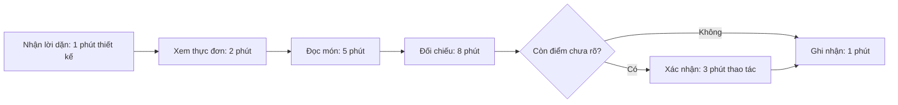
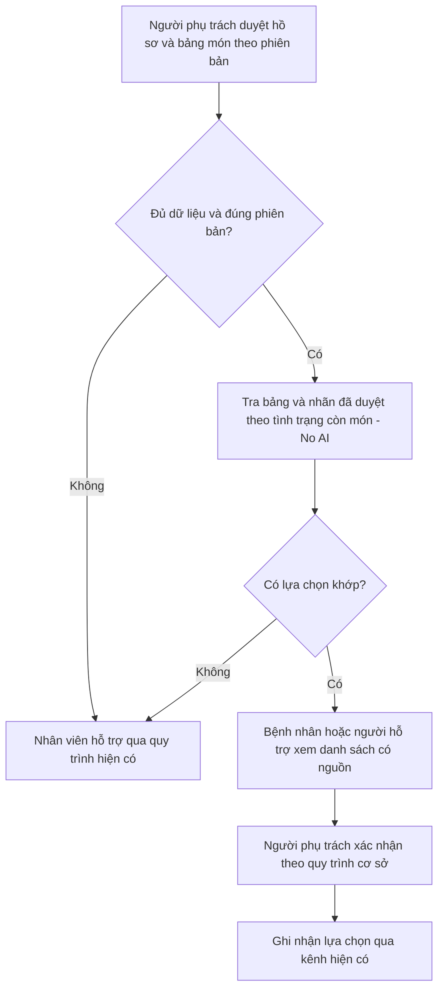

# Báo cáo nhóm — A90 — Discovery & Problem Framing

## 1. Thông tin nhóm

- Tên nhóm: A90.
- Thành viên: Chu Quang Linh, Nguyễn Lê Trọng Mạnh, Vũ Duy Khánh, Vũ Văn Chủ; xem [TEAM.md](../../TEAM.md).
- Candidate problem được chọn: **Khi đã biết lời dặn ăn uống và đứng trước nhiều món, bệnh nhân muốn biết nhanh món nào phù hợp, để chọn tự tin mà không phải đọc kỹ từng món.**
- Nguồn candidate: Card #1 của Mạnh; lựa chọn được Linh xác nhận trong chat.
- Actor trọng tâm: bệnh nhân nội trú có chế độ ăn đã được người có chuyên môn xác nhận; cần kiểm tra khả năng tự thao tác hoặc có người hỗ trợ.
- Bối cảnh tham chiếu: Vinmec; chưa xác nhận cơ sở/khoa hoặc đối tác khảo sát.
- Mức chọn phân tích: **No AI** cho vòng thử đầu. Rule là phương án sau nếu có căn cứ; chưa chọn Workflow/Agent.
- Quyết định phân tích: **Not Yet — chưa triển khai cho người bệnh**, cần kiểm chứng pain, dữ liệu và cơ chế duyệt.

## 2. Hội tụ nhóm (CP3)

### 2.1. Pitch và truy vết phản biện

Danh sách candidate lấy từ báo cáo cá nhân. Việc có mặt trong bảng không chứng minh tất cả đã được pitch. Câu hỏi được đối chiếu trong [sổ phản biện](../assets/cp3-so-doi-chieu-phan-bien.md); không tự đặt người hỏi/người nhận chưa rõ.

| # | Người đưa ra | Candidate | Actor | Bottleneck / dữ liệu hiện có | Phản biện được ghi |
|---:|---|---|---|---|---|
| 1 | Linh | Kiểm tra bài trước nộp | Sinh viên | Khoảng 10 phút kiểm tra; từng sót 2 vấn đề do yêu cầu mơ hồ; chưa tách từng bước | Q02: hỏi phần trăm giảm thời gian, chưa rõ người hỏi; chưa có số trước/sau |
| 2 | Linh | Làm rõ nhiệm vụ nhóm | Thành viên nhận việc | Khoảng 20 phút tìm/đọc lại và 3 lượt hỏi; chưa rõ thời gian chờ | Chưa có ghi nhận cụ thể |
| 3 | Linh | Chốt việc sau họp | Người tổng hợp việc | Khoảng 45 phút; 2 việc thiếu người phụ trách | Chưa có ghi nhận cụ thể |
| 4 | Mạnh | Chọn món phù hợp lời dặn ăn uống | Bệnh nhân nội trú | Khoảng 20 phút là ước lượng chưa rõ mỗi bữa/ngày; chưa có thời gian từng bước | Q03, Q06: tiết kiệm thời gian, thay thế bộ phận, lợi nhuận; chưa rõ người hỏi |
| 5 | Mạnh | Nhận thông tin khi đổi y lệnh ăn uống | Điều dưỡng; bệnh nhân/người nhà | Ước lượng độ trễ 10 phút, chưa có trường hợp đối chiếu | Chưa có ghi nhận cụ thể |
| 6 | Mạnh | Ghi lý do thức ăn bỏ thừa | Người ghi; nhân viên dinh dưỡng | Ước lượng 2 phút/lần; actor chính chưa chốt | Chưa có ghi nhận cụ thể |
| 7 | Khánh | Hiểu yêu cầu từ nhiều file lab | Học viên | Card nêu 20 phút xâu chuỗi công việc, chưa đo riêng | Chưa có ghi nhận cụ thể |
| 8 | Khánh | Tra lệnh Git | Học viên | Card nêu 3–5 phút/lần, ước lượng | Chưa có ghi nhận cụ thể |
| 9 | Khánh | Đi học đúng giờ | Học viên đi tàu/xe buýt | Ước lượng từng chặng; giờ xuất phát và tần suất muộn cần đối chiếu | Có phản biện AI trong CP2; chưa dùng làm câu hỏi của thành viên tại CP3 |
| 10 | Chủ | Xác minh yêu cầu chuyển tiền | Sinh viên | Ước lượng 8 phút tìm nguồn; không phải số đo | Q01: Linh hỏi về lợi nhuận; hai báo cáo có cùng câu hỏi, thiếu phản hồi cụ thể |
| 11 | Chủ | Đối chiếu tin tuyển dụng | Sinh viên tìm việc | Ước lượng 12 phút tìm và đối chiếu nguồn | Chưa có ghi nhận cụ thể |
| 12 | Chủ | Kiểm tra hồ sơ thuê trọ | Sinh viên thuê trọ | Ước lượng 12 phút đối chiếu hồ sơ | Chưa có ghi nhận cụ thể |

### 2.2. Cluster

Bản phân nhóm phân tích, cần nhóm xác nhận; không phải biên bản hoạt động đã diễn ra.

| Cluster | Candidate | Pattern chung |
|---|---|---|
| A — Hiểu và đối chiếu thông tin | 1, 2, 7, 8, 10, 11, 12 | Nguồn phân tán; khó hiểu yêu cầu hoặc kiểm tra thông tin |
| B — Phối hợp và chuyển giao | 3, 5 | Người nhận, thời điểm hoặc trạng thái thông tin chưa rõ |
| C — Lựa chọn và phản hồi suất ăn | 4, 6 | Cần đối chiếu món với điều kiện đã biết và phản hồi kết quả |
| D — Di chuyển | 9 | Thời gian tuyến đường và giờ xuất phát cần dự phòng |

### 2.3. Opportunity Solution Tree rút gọn

```text
OUTCOME: Rút ngắn thời gian chọn món mà không tăng lựa chọn không khớp dữ liệu đã duyệt
├── Opportunity A: Khó đối chiếu lời dặn đã xác nhận với thông tin từng món
├── Opportunity B: Chưa rõ thông tin món/chế độ ăn có đầy đủ và còn hiệu lực không
└── Opportunity C: Chưa có cách hỗ trợ phù hợp khi bệnh nhân không tự thao tác được
```

“Chatbot tư vấn ăn uống”, “AI đọc bệnh án” và “ứng dụng tự đặt món” là solution, không đặt ở tầng opportunity. Các opportunity trên còn là giả thuyết cần kiểm chứng.

### 2.4. So sánh shortlist

Điểm 1–5 là đánh giá do nhóm đã thảo luận/chấm. Cột bằng chứng đánh giá chất lượng dữ liệu hiện có, không đánh đồng một ước lượng với quan sát đã đo.

| Candidate | Actor rõ | Quy trình rõ | Pain có bằng chứng | Impact đo được | Vừa sức lab | So sánh được 4 mức | Nhóm hiểu domain | Tổng |
|---|---:|---:|---:|---:|---:|---:|---:|---:|
| Chọn món theo lời dặn đã xác nhận | 5 | 4 | 2 | 4 | 3 | 5 | 3 | 26 |
| Kiểm tra bài trước nộp | 5 | 5 | 3 | 5 | 5 | 4 | 5 | 32 |
| Xác minh yêu cầu chuyển tiền | 4 | 4 | 2 | 3 | 3 | 4 | 3 | 23 |

**Candidate được chọn:** chọn món theo lời dặn ăn uống, theo xác nhận trực tiếp của Linh; không khẳng định là lựa chọn có tổng điểm cao nhất.

**Lý do lựa chọn cần nhóm xác nhận:** actor và thời điểm lựa chọn cụ thể; có thể khoanh phạm vi ở chế độ ăn đã duyệt; có cơ hội so sánh cách trình bày thực đơn, Rule và hỗ trợ giải thích. Khó khăn dữ liệu được giữ thành điều kiện kiểm chứng, không bỏ qua để chọn Go.

**Lý do chưa chọn hai hướng còn lại trong vòng này:** kiểm bài gần gũi và vừa sức hơn nhưng nhóm đã chọn đào sâu bối cảnh suất ăn; xác minh chuyển tiền phụ thuộc nguồn độc lập và khả năng dừng hành động khi bị thúc ép, khó đánh giá đủ trong buổi lab. Đây là lập luận nháp, không gán cho cá nhân đã phát biểu.

**Xử lý bất đồng:** chưa có ghi nhận bất đồng thực tế; không dựng kết quả biểu quyết.

### 2.5. Phiên phản biện AI

| Vai | Câu hỏi đặt ra  | Câu hỏi nhận và trả lời |
|---|---|---|
| Linh | P04, P07, P11, P15 | P01, P02, P03 |
| Mạnh | P01, P08, P12 | P04, P05, P06, P13, P14 |
| Khánh | P03, P06, P10, P14 | P07, P08, P09 |
| Chủ | P02, P05, P09, P13 | P10, P11, P12, P15 |

Kết quả phân tích giữ nguyên card chung; baseline 20 phút cần xác minh đơn vị; No AI/Rule là hướng thử trước, Workflow/Agent chưa chọn; quyết định Not Yet. Câu trả lời phân biệt dữ liệu đã cung cấp, điều chưa biết và thay đổi đề xuất; không thêm kết quả tiết kiệm thời gian, lợi nhuận hoặc phỏng vấn chưa có.

Các báo cáo cá nhân mục 4.1 dẫn cùng bộ câu hỏi–trả lời để tránh lệch nội dung. bốn thành viên đã tự thực hiện CP3 trực tiếp hoặc tự đạt điểm C3/C6.

## 3. Kiểm chứng và research (CP4)

### 3.1. Assumption Map

nhóm tự đánh giá. Mức bằng chứng 1 là rất ít, 5 là mạnh.

| # | Giả định | Loại | Quan trọng (1–5) | Bằng chứng (1–5) | Kiểm trước? |
|---:|---|---|---:|---:|---|
| A1 | Bệnh nhân gặp khó khi đối chiếu lời dặn với món, không chỉ khi chưa biết chế độ ăn | Value | 5 | 1 | Có |
| A2 | Thực đơn, thành phần, trạng thái còn món và chế độ ăn có phiên bản dùng được | Feasibility | 5 | 1 | Có |
| A3 | Có người phụ trách chuyên môn duyệt bảng tương thích và xử lý ngoại lệ | Viability | 5 | 1 | Có |
| A4 | Bệnh nhân/người hỗ trợ đọc và hiểu được danh sách đã giới hạn | Usability | 4 | 1 | Có |
| A5 | Nhãn thực đơn hiện có chưa đủ giải quyết pain | Value | 5 | 1 | Có — cần tìm cả tín hiệu phản bác |
| A6 | Lợi ích lớn hơn công chuẩn bị/cập nhật và duyệt dữ liệu | Feasibility / Viability | 4 | 1 | Có — cần đo cả công ngoài lượt |

Ưu tiên A1, A2, A5: xác định pain và phương án đơn giản trước khi bàn thêm AI.

### 3.2. Bằng chứng hiện có và phần chưa thực hiện

| Nguồn | Số mẫu | Tín hiệu xác nhận | Tín hiệu phản bác / giới hạn |
|---|---:|---|---|
| Ước lượng trong báo cáo Mạnh | 1 báo cáo cá nhân; không phải 1 bệnh nhân được phỏng vấn | Có giả thuyết mất khoảng 20 phút để chọn/đối chiếu | Chưa rõ mỗi bữa/ngày, ai được quan sát, thời điểm và cách lấy số |
| Hướng dẫn nội trú Vinmec [R0] | 1 trang công khai | Có quy trình cung cấp bữa ăn và nhận lựa chọn thực đơn | Nguồn mô tả nhân viên phục vụ phòng nhận lựa chọn cho ngày hôm sau vào 13–15 giờ; không chứng minh bệnh nhân đang tự đặt món trên app hoặc cần 20 phút |
| Phỏng vấn / survey đúng đối tượng | **0 kết quả được cung cấp** | Chưa có | Chưa đạt yêu cầu 2–3 phỏng vấn hoặc survey 5–10 người |

Không tạo Interview Snapshot hay câu nói nguyên văn khi chưa hỏi người thật. Cần phỏng vấn 2–3 người đúng vai trò ngoài nhóm, hoặc survey 5–10 người; ghi vai trò, thời điểm, cách hỏi và ẩn danh. Nếu chưa tiếp cận bệnh nhân/điều dưỡng, giữ Not Yet.

Thông tin cần ghi sau khi hỏi: lần gần nhất chọn món; từng bước đang làm; lời dặn đến từ đâu; điểm khó; thời gian; cách xử lý hiện tại; nhãn thực đơn sẵn có; trường hợp người dùng thấy cách hiện tại đã đủ. Tín hiệu “đã có nhân viên hỗ trợ và không cần công cụ” cũng phải được giữ.

**Điều đã sửa sau rà soát nguồn, chưa phải sau phỏng vấn:** thu hẹp từ suy luận món theo bệnh án sang hỗ trợ đối chiếu chế độ ăn đã xác nhận; không mặc định tự đặt món, giữ kênh nhân viên đang có; chưa khẳng định pain riêng tại Vinmec.

### 3.3. Research giải pháp đã có

 [Sổ kiểm nguồn và kế hoạch kiểm chứng CP4](../assets/cp4-research-va-ke-hoach-kiem-chung-ai.md) ghi claim, giới hạn, giả định và cách thu thập bằng chứng. Không suy ra kiến trúc bên trong là Rule hay AI nếu nguồn không nêu.

| Công cụ / case | Link | Giải bước nào? | Điểm mạnh theo nguồn | Khoảng trống / rủi ro | Bài học phân tích |
|---|---|---|---|---|---|
| CBORD Patient tại Cambridge Memorial Hospital [R1] | https://www.cmh.org/patients/how-order-patient-meals | Hiển thị lựa chọn theo dữ liệu ăn uống và hỗ trợ đặt món | Cá nhân hóa theo hồ sơ; có kênh hỗ trợ khi không dùng app | Có nhóm chế độ ăn không được dùng app; dữ liệu nhập vào vẫn là điều kiện đầu vào | Cần kiểm đủ điều kiện sử dụng và giữ kênh người hỗ trợ |
| Computrition HS onTray tại PVHMC [R2] | https://www.pvhmc.org/blog/2025/july/pvhmc-receives-prodigy-award-for-innovation-from/ | Tự chọn suất ăn theo điều kiện đã chỉ định | Bệnh viện mô tả lựa chọn theo chế độ ăn/dị ứng và triển khai theo giai đoạn | Không cung cấp baseline chọn món hoặc bằng chứng hiệu quả tại Vinmec | Thử phạm vi nhỏ, kiểm dữ liệu và thao tác trước khi mở rộng |
| MyChart Bedside tại UW Health [R3] | https://www.uwhealth.org/files-directory/mychart/Dining/MYC_MealOrder.pdf | Chọn bữa, xem thông tin liên quan và gửi đơn | Có hướng dẫn thao tác và đầu mối hỗ trợ | Chỉ áp dụng một số chế độ ăn; thay đổi chỉ định có thể cần gọi nhân viên | Cần xử lý đổi phiên bản và phương án quay về |

**Kết luận research:** đã có các pattern hỗ trợ chọn món; chưa có căn cứ tự xây Agent. Đề xuất thử danh sách đã duyệt/Rule là suy luận của bản nháp, không phải mô tả kiến trúc các sản phẩm trên. Research không thay thế kiểm chứng người dùng tại cơ sở dự kiến.

### 3.4. CP4
Đã hoàn thành bốn việc: mở lại R0–R3; lập sổ phân biệt claim và suy luận; phản biện sáu giả định; thiết kế bộ 9 câu hỏi hành vi cùng trường ghi bằng chứng. Có thêm năm tình huống để diễn tập cách xử lý tín hiệu phản bác trong [hồ sơ CP4](../assets/cp4-research-va-ke-hoach-kiem-chung-ai.md).


## 4. Quy trình trước/sau (CP5)

### 4.1. Quy trình hiện tại cần xác nhận

Đây là mô hình từ Card #1 của Mạnh, không khẳng định đã quan sát tại Vinmec. Khi khảo sát phải đối chiếu kênh nhân viên nhận lựa chọn mô tả trong [R0]. Ngày 10/11/2026, AI bổ sung một kịch bản **20 phút/một lượt có hỏi làm rõ** để diễn tập; số phút từng bước là tổng hợp, không xác nhận đơn vị của ước lượng gốc. Chi tiết tại [hồ sơ CP5](../assets/cp5-quy-trinh-va-phan-bien-ai.md).

| Bước | Actor | Input | Output | Thời gian / tần suất | Trạng thái |
|---:|---|---|---|---|---|
| 1 | Bệnh nhân/người hỗ trợ | Lời dặn đã xác nhận | Điều kiện để đối chiếu | Thiết kế 1 phút; chưa đo | Cần xác nhận kênh truyền; không tính thời gian ra chỉ định |
| 2 | Bệnh nhân/người hỗ trợ | Thực đơn ca/ngày | Các món cần xem | Thiết kế 2 phút; chưa đo | Cần xem thực đơn thật |
| 3 | Bệnh nhân/người hỗ trợ | Món và thông tin đi kèm | Thông tin để đối chiếu | Thiết kế 5 phút; chưa đo | Có thể thiếu thành phần |
| 4 | Bệnh nhân/người hỗ trợ | Lời dặn và thông tin món | Lựa chọn sơ bộ/điểm chưa rõ | Thiết kế 8 phút; chưa đo | Nghẽn lớn nhất trong mô hình, chưa phải quan sát |
| 5 | Nhân viên được phân công; người chọn | Câu hỏi chưa rõ | Xác nhận lựa chọn hoặc ngoại lệ | Thiết kế 3 phút thao tác; chưa đo chờ | Mô hình có một lượt hỏi, không áp dụng mọi ca |
| 6 | Bệnh nhân; nhân viên nhận lựa chọn | Lựa chọn đã được xác nhận | Ghi nhận qua kênh hiện có | Thiết kế 1 phút; chưa đo | Không mặc định có app tự đặt |



**Bottleneck:** bước 4 chiếm 8/20 = 40% trong mô hình tổng hợp; bước 3–4 chiếm 65%. Thời gian thật và phạm vi 20 phút trong bài Mạnh vẫn chưa xác định. Đường không hỏi có tổng thiết kế 17 phút, không ép mọi ca thành 20 phút.

### 4.2. Quy trình tương lai đề xuất



Thử No AI bằng bản giấy/nhãn đã duyệt trước. Rule chỉ áp dụng logic do cơ sở phê duyệt; nhóm không tự tạo quy tắc dinh dưỡng. Không dùng AI suy đoán phần thiếu. Hỏng hệ thống, dữ liệu cũ/thiếu, không có món khớp hoặc người dùng không thao tác được thì quay về nhân viên hỗ trợ; không tự nới điều kiện.

Phân rã thời gian sau — kịch bản tổng hợp, không phải kết quả thử:

| Bước | Actor / mức xử lý | Input → output | Phút thiết kế | Điểm kiểm |
|---:|---|---|---:|---|
| F1 | Nhân viên phụ trách; con người | Nguồn/phiên bản → trạng thái đủ dữ liệu | 2 | Thiếu/cũ thì dừng và hỗ trợ |
| F2 | Con người tra bảng No AI; hoặc Rule nếu được chọn sau | Bảng đã duyệt + tình trạng còn món → danh sách | 1 | Không có món khớp thì không tự nới điều kiện |
| F3 | Bệnh nhân/người hỗ trợ | Danh sách có nguồn → lựa chọn sơ bộ | 2 | Có đường hỗ trợ khi không thao tác được |
| F4 | Người phụ trách; con người | Lựa chọn và dữ liệu → xác nhận/ngoại lệ | 5 | Giữ bước duyệt dù có Rule |
| F5 | Người chọn/nhân viên nhận | Lựa chọn được xác nhận → bản ghi qua kênh hiện có | 4 | Không tự gửi đặt món hoặc đổi điều kiện |
| **Tổng** | | **Một đường đi bình thường của mô hình** | **14** | **Chưa tính chờ phát sinh** |

Chuẩn bị dữ liệu giả định 60 phút/phiên bản thực đơn, ghi riêng ngoài 14 phút mỗi lượt. No AI và Rule chưa được đo so sánh; dùng cùng con số F2 chỉ để diễn tập. [Hồ sơ CP5](../assets/cp5-quy-trinh-va-phan-bien-ai.md) có sơ đồ đủ thời gian, bảng handoff và [fixture](../assets/cp5-mo-hinh-thoi-gian.json).

### 4.3. Before/after để kiểm khi pilot

| Chỉ số | Trước | Sau — target đề xuất | Cách kiểm |
|---|---|---|---|
| Thời gian một lượt chọn món | Chưa đo; có ước lượng khoảng 20 phút chưa rõ phạm vi | Giảm trung vị ≥30% sau khi xác lập baseline cùng phạm vi | Đo thao tác/chờ riêng; gồm cả thời gian kiểm tra và sửa |
| Lựa chọn không khớp bảng đã duyệt | Chưa có baseline | 0 trong tập thử được người có chuyên môn chấm | Một lỗi chặn thì dừng, không bù bằng tốc độ |
| Thông tin thiếu/cũ | Chưa có số hiện trạng | 100% mẫu thử thiếu/cũ chuyển người phụ trách | Kiểm log trạng thái và phiên bản |
| Chi phí chuẩn bị dữ liệu | Chưa đo | Phải ghi riêng, không bỏ khỏi đánh giá khả thi | Ghi phút lập/cập nhật bảng món |
| Rủi ro mới | Chưa có công cụ mới | Có thể tin nhầm nhãn, dùng bản cũ, bỏ qua hỗ trợ | Kiểm boundary, phiên bản và fallback |

Đối chiếu bổ sung **chỉ trong mô hình**: 6 → 5 bước; 20 → 14 phút thao tác, giảm 30%; No AI vẫn là 5 bước thủ công, biến thể Rule còn 4/5 nếu F2 tự động hóa. Tính công chuẩn bị 60 phút thì hòa vốn tại 10 lượt; với 20 lượt, tổng 400 → 340 phút công, giảm 15%. Không dùng lợi ích mỗi lượt thay lợi ích tổng hoặc lợi ích người bệnh thay công nhân viên.

## 5. Problem Statement v0

| Trường | Nội dung |
|---|---|
| Actor | Bệnh nhân nội trú có chế độ ăn đã được người có chuyên môn xác nhận; cần người hỗ trợ nếu không tự thao tác |
| Quy trình | Nhận lời dặn → xem thực đơn → đọc món → đối chiếu → hỏi nếu cần → ghi nhận lựa chọn |
| Bottleneck | Khó đối chiếu thông tin món với lời dặn; bước và thời gian chính xác chưa xác minh |
| Impact | Có thể tốn công chọn món và hỏi lại; chưa có số mẫu, tỷ lệ lỗi hoặc thiệt hại tại cơ sở |
| Success Metric | Xác lập baseline cho một lượt trước; target đề xuất giảm trung vị ≥30% và không có lựa chọn không khớp bảng duyệt trong tập thử |
| Boundary | Không tự quyết định chế độ ăn, suy đoán thành phần/dị ứng hoặc tự đặt món; giữ người phụ trách xác nhận |

**Phản biện biên tập AI:** chưa rõ đơn vị 20 phút; chưa biết nhãn hiện có đã đủ chưa; cần đánh giá cả thời gian chuẩn bị dữ liệu và người không dùng giao diện. Bản v1 bổ sung điều kiện dữ liệu/phiên bản và trạng thái Not Yet; chưa ghi là nhóm đã đồng ý sau một buổi phản biện.

Phiên CP5 ngày 10/11/2026 bổ sung sáu phản biện V01–V06 và cách sửa: tách baseline khỏi mô hình, giữ bước duyệt, kiểm phiên bản, tính công chuẩn bị, không mặc định Rule tốt hơn và phân biệt các đường đi. Xem [mục 7 hồ sơ CP5](../assets/cp5-quy-trinh-va-phan-bien-ai.md). hoạt động tự viết/đánh giá của các thành viên.

## 6. Mức can thiệp (CP6)

### 6.1. Ma trận mơ hồ × phức tạp

Nếu có đủ bảng tương thích đã duyệt, logic lọc có độ mơ hồ thấp; phần khó nằm ở dữ liệu, cập nhật và phối hợp. Nhiều bên tham gia không tự tạo lý do dùng Agent. Không dùng mô hình ngôn ngữ để lấp thiếu dữ liệu chuyên môn.

### 6.2. So sánh bốn mức

| Mức | Phương án | Đủ khi nào | Rủi ro | Đề xuất |
|---|---|---|---|---|
| No AI | Nhãn hoặc danh sách giấy được duyệt; nhân viên hỗ trợ | Kiểm giá trị của cách trình bày đơn giản trước khi thêm xử lý tự động | Nhãn cũ, thiếu trạng thái phiên bản | **Chọn cho vòng đầu; chưa triển khai** |
| Rule | Lọc theo bảng tương thích, phiên bản và tình trạng còn món đã duyệt | Có dữ liệu đủ, No AI chưa đủ và cần đối chiếu nhiều điều kiện | Dữ liệu sai/cũ; bảng quy tắc chưa được duyệt | Phương án sau, **chưa chọn** |
| Workflow | Rule lọc → AI diễn giải có nguồn → người phụ trách kiểm | Có bằng chứng phần giải thích vẫn gây khó sau cách đơn giản | Bịa giải thích, tăng thời gian kiểm | Chưa chọn |
| Agent | Tự tìm thông tin và tự quyết bước tiếp | Chưa chứng minh cần thiết | Mở rộng quyền và khó kiểm soát | Không chọn |

### 6.3. AI Canvas và PAIR

Chưa chọn giải pháp có AI dự đoán/tạo nội dung nên không cần điền AI Canvas theo worksheet. Rule không tự đưa ra chỉ định; con người duyệt dữ liệu và ngoại lệ. Khi cân nhắc Workflow sau này, phải kiểm chứng nhu cầu giải thích, tiêu chí đúng nguồn và chi phí người kiểm trước khi thêm AI.

## 7. Problem Statement v1 và tiêu chí đánh giá

| Trường | Nội dung |
|---|---|
| Actor | Như v0, thêm điều kiện cơ sở xác nhận đủ điều kiện tự chọn hoặc có người hỗ trợ |
| Quy trình | Như v0; không thay kênh nhận lựa chọn hiện có khi chưa khảo sát |
| Bottleneck | Đối chiếu món/lời dặn là giả thuyết; cần quan sát để xác định một bước cụ thể |
| Impact | Chưa đủ dữ liệu định lượng; không suy ra lợi nhuận hoặc giảm thời gian đã đạt |
| Success Metric | Baseline cùng phạm vi trước pilot → target trung vị giảm ≥30%; 0 lựa chọn không khớp bảng duyệt; 100% mẫu thiếu/cũ chuyển xác nhận |
| Boundary | Chỉ dùng dữ liệu và quy tắc cơ sở duyệt; không suy đoán; không đổi chế độ ăn; không tự đặt món |
| AI intervention point | Không có trong hướng đề xuất hiện tại |
| Mức chọn phân tích | **No AI**; Rule chưa chọn, chỉ xét khi có điều kiện và bằng chứng |
| Rủi ro và người kiểm tra | Người phụ trách chuyên môn do cơ sở chỉ định kiểm bảng món, phiên bản và ngoại lệ; nhóm chưa có người nhận vai này |

| Trường | v0 | v1 | Vì sao |
|---|---|---|---|
| Phạm vi | Bệnh nhân có lời dặn | Thêm điều kiện đủ dữ liệu/phiên bản và có hỗ trợ | Research cho thấy có ca không đủ điều kiện tự chọn |
| Can thiệp | Chưa xác định | Chọn No AI cho vòng đầu; Rule là khả năng sau | Chưa chứng minh cần xử lý tự động hoặc tạo nội dung |
| Quyết định | Chưa đánh giá đủ | Not Yet | Chưa có kiểm chứng người dùng và dữ liệu tại cơ sở |

Tiêu chí cho giải pháp không dùng AI:

| # | Tiêu chí | Đạt khi | Không đạt khi |
|---:|---|---|---|
| 1 | Khớp bảng duyệt | Mọi món hiển thị đều được bảng hiện hành cho phép | Có món bảng loại vẫn được cho chọn |
| 2 | Không suy đoán | Mục thiếu/cũ chuyển xác nhận | Tự điền thành phần/chế độ hoặc coi thiếu là không có |
| 3 | Truy vết | Có nguồn và phiên bản hồ sơ, món, bảng duyệt | Không truy được dữ liệu quyết định |
| 4 | Dùng và quay về được | Có người hỗ trợ khi cần, giữ kênh hiện có | Người không thao tác được bị bỏ lại hoặc không có fallback |
| 5 | Có lợi ích đo được | Target thời gian chỉ tính khi vượt kiểm chất lượng, tính cả khâu sửa | Giảm thời gian bằng bỏ bước duyệt hoặc bỏ chi phí chuẩn bị dữ liệu |

Có [10 mẫu eval, 10 lượt thời gian và 4 kịch bản quyết định tổng hợp](../assets/cp6-du-lieu-tong-hop-de-thu-eval.md), kèm [fixture JSON](../assets/cp6-fixture-tong-hop.json) để diễn tập. Chưa có kết quả chạy giải pháp hoặc dữ liệu người dùng thật; dữ liệu này không thay phần kiểm chứng CP4.

Ngày 10/11/2026 đã chạy [kiểm tra tính nhất quán fixture](../assets/cp6-ket-qua-kiem-tra-fixture.json): kiểm ID/số mẫu, phép tính và bốn kịch bản ngưỡng quyết định. Không gọi kết quả này là tỷ lệ đúng của sản phẩm; 10 mẫu E01–E10 mới là expected outputs, chưa có sản phẩm chạy.

## 8. Quyết định (CP6)

### 8.1. Bốn rủi ro — đánh giá nháp

| Rủi ro | Mức | Lý do và dữ liệu cần thêm |
|---|---|---|
| Value | Cao | Chưa phỏng vấn; nhãn/nhân viên hiện có có thể đã đủ; 20 phút chưa đo |
| Usability | Trung bình | Chưa quan sát người dùng; cần xác nhận khả năng thao tác và hỗ trợ |
| Feasibility | Cao | Chưa có bảng món, quy tắc, phiên bản và nguồn cập nhật dùng được |
| Viability | Cao | Chưa có cơ sở cho phép, người duyệt và người vận hành; không dùng bệnh án thật trong repo |

### 8.2. Kết luận và bước tiếp theo

**Not Yet.** Lựa chọn candidate không đồng nghĩa được triển khai. Không viết Go có điều kiện khi vẫn thiếu các điều kiện cốt lõi và rủi ro Cao chưa giảm.

Đầu ra phân tích CP6 đã được chốt tại [hồ sơ CP6](../assets/cp6-phan-tich-va-quyet-dinh-ai.md);cả nhóm đã tự biểu quyết. Mức No AI và trạng thái Not Yet là hai trường riêng.

- **Bước tiếp theo đề xuất:** xác nhận một cơ sở/khoa và người phụ trách; xem thực đơn thật được phép dùng; phỏng vấn 2–3 người đúng vai trò ngoài nhóm hoặc survey 5–10 người; đo baseline và ghi cả tín hiệu phản bác.
- **Thử nghiệm nhỏ nhất sau khi đủ điều kiện:** so sánh thực đơn hiện tại với nhãn/danh sách đã duyệt; chỉ thử Rule khi No AI chưa đủ. Có thể diễn tập bằng dữ liệu tổng hợp trước, không đưa cho bệnh nhân dùng như công cụ thật.
- **Ngưỡng dừng đề xuất:** trong tuần chuẩn bị đầu tiên, nếu không có dữ liệu được phép dùng hoặc người duyệt thì dừng kế hoạch pilot tại cơ sở; một lỗi chặn trong kiểm bảng thì dừng bản thử; nếu No AI đã đạt target thì không thêm AI.
- **Chuyển Go khi nào:** nhóm có bằng chứng Value, nguồn dữ liệu/phê duyệt/vận hành và đánh giá lại không còn rủi ro Cao. Các ngưỡng là kế hoạch, chưa phải kết quả thử.


## 9. Tài liệu tham khảo

- [R0 — Hướng dẫn nội trú Vinmec](https://www.vinmec.com/vie/bai-viet/huong-dan-danh-cho-khach-hang-dieu-tri-noi-tru-tai-vinmec-vi): bối cảnh nhận lựa chọn thực đơn; không chứng minh pain/baseline.
- [R1 — Cambridge Memorial Hospital / CBORD Patient](https://www.cmh.org/patients/how-order-patient-meals).
- [R2 — PVHMC / Computrition HS onTray](https://www.pvhmc.org/blog/2025/july/pvhmc-receives-prodigy-award-for-innovation-from/).
- [R3 — UW Health / MyChart Bedside](https://www.uwhealth.org/files-directory/mychart/Dining/MYC_MealOrder.pdf).
- [Worksheet](../../docs/01-worksheet.md), [Rubric](../../RUBRIC.md), [sổ đối chiếu phát biểu](../assets/cp3-so-doi-chieu-phan-bien.md).
